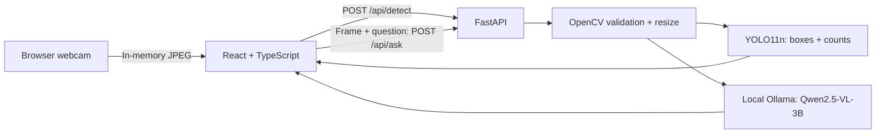

# Vision · Local AI Assistant

A private webcam dashboard combining **YOLO11n detection** and **Qwen2.5-VL-3B visual Q&A** through local Ollama. Built with Python 3.11, FastAPI, OpenCV, React, TypeScript, Vite and Tailwind CSS.

No cloud AI, API keys, database, accounts or Docker. Camera images are processed in memory and never saved by the application.

## Features

- Camera start/stop, permission errors, disconnect recovery and cleanup on navigation.
- Detection approximately every 1.5 seconds without overlapping requests; background tabs pause detection.
- Bounding boxes, confidence, counts, measured prediction latency and browser round-trip time.
- Fresh-frame questions with measured backend response time, elapsed loading state and cancellation.
- Independent visual Q&A: Qwen receives the full frame even when YOLO detects nothing. Ask about a watch or pen without needing a detection box.
- English and best-effort Uzbek Latin answers, with an explicit Uzbek accuracy notice.
- Responsive dark workspace with model availability, warm-up states and actionable errors.

## Architecture



Detection and Q&A are independent. One request per inference path runs at a time; excess requests receive `429`. Model warm-up runs in the background. OpenCV and YOLO run off the async event loop. Cancelling a question closes the upstream Ollama request; the runner may take a moment to stop.

```text
backend/     FastAPI routes, image validation, detector, vision client, tests
frontend/    React dashboard, camera lifecycle, contained video/box stage, API client
.env.example Local configuration defaults; copy to .env
```

## Quick start · Windows PowerShell

Install [Python 3.11](https://www.python.org/downloads/release/python-3119/), [Node.js 22+](https://nodejs.org/) and [Ollama](https://ollama.com/download/windows). Weights require several GB of disk space. Available RAM/VRAM determines loading time and capacity; a GPU is optional.

From the project root:

```powershell
Copy-Item .env.example .env
py -3.11 -m venv .venv
.\.venv\Scripts\python.exe -m pip install -r backend\requirements.txt
Set-Location frontend
npm.cmd ci
Set-Location ..
ollama pull qwen2.5vl:3b
```

If `py` is unavailable, use your Python 3.11 executable instead. If `ollama` is absent from PATH, reopen PowerShell or use `& "$env:LOCALAPPDATA\Programs\Ollama\ollama.exe"`. An already prepared `.venv` and installed frontend dependencies can be reused.

Run in separate terminals:

```powershell
# 1. Skip if the Ollama app is already serving locally.
ollama serve

# 2. Project root; virtualenv activation is unnecessary.
.\.venv\Scripts\python.exe -m uvicorn backend.main:app --host 127.0.0.1 --port 8000

# 3. Project root
Set-Location frontend
npm.cmd run dev
```

Open **http://127.0.0.1:5173**, start the camera and allow access. Use localhost or HTTPS; remote plain HTTP cannot access the camera. `npm.cmd` avoids PowerShell script-policy issues. YOLO downloads `yolo11n.pt` on first startup; after both model downloads, inference works offline.

## Configuration and performance

Restart FastAPI after editing root `.env`; restart Vite after changing `VITE_API_URL`.

| Setting | Default | Purpose |
| --- | --- | --- |
| `YOLO_IMAGE_SIZE` | `768` | Balanced detail; `640` reduces work, `960` retains more small-object detail at higher cost |
| `YOLO_CONFIDENCE` | `0.30` | Retains more candidates than the original 0.35 threshold; may increase false positives |
| `YOLO_DEVICE` | `cpu` | Leaves GPU memory for Qwen; use `0` with CUDA-enabled PyTorch if desired |
| `OLLAMA_URL` | `http://127.0.0.1:11434` | Local Ollama service |
| `OLLAMA_MODEL` | `qwen2.5vl:3b` | Required vision model |
| `OLLAMA_TIMEOUT` | `180` seconds | Total vision deadline, including recovery; connect timeout is 3 seconds |
| `OLLAMA_NUM_CTX` | `4096` | Bounded context/memory |
| `OLLAMA_MAX_TOKENS` | `384` | Bounds answer length and generation work |

YOLO uses single-scale prediction, rectangular padding and at most 100 boxes. Larger inputs can preserve small-object detail but do not guarantee better accuracy. See [Ultralytics prediction settings](https://docs.ultralytics.com/modes/predict/). No accuracy improvement or hardware-independent speedup is claimed without a labeled benchmark.

The UI displays measured times: **prediction** is the YOLO call after warm-up; **round trip** includes browser transport and backend work; **AI response** covers backend image preparation plus Ollama. The live AI timer measures time since sending. Cold model loads can be much slower. The 1.5-second sampling target is not a frame-rate guarantee. Ollama remains resident for five minutes after use.

## API

Interactive schema: **http://127.0.0.1:8000/docs**.

| Endpoint | Request | Response |
| --- | --- | --- |
| `GET /health` | — | Detector readiness/settings; Ollama availability and busy state |
| `POST /api/detect` | `{ "image": "data:image/jpeg;base64,..." }` | `objects`, `counts`, `total`, `inference_ms`, `processing_ms`, `width`, `height` |
| `POST /api/ask` | `{ "image": "...", "question": "What is this object?", "language": "en" }` | `answer`, `language`, `model`, `elapsed_ms` |

Images: JPEG/PNG base64, raw or data URL; maximum 5 MB decoded, 16–4096 pixels per edge, downscaled to a maximum 1280-pixel edge. Questions: 1–2000 characters; languages: `en`, `uz`. Boxes are `[x1, y1, x2, y2]` normalized to the decoded frame rather than YOLO's padded tensor. Video and overlays share one contained rectangle in landscape, portrait and fullscreen.

`422`: invalid input; `413`: oversized request; `429`: busy inference; `503`: unavailable/warming service; `502`: invalid/upstream failure; `504`: AI timeout. Ollama `ready` means the model is installed and reachable; it does not claim the runner is loaded. Vite's development proxy forwards `/api` and `/health` to port 8000. For separate hosting, set `VITE_API_URL` and allow the frontend origin in `CORS_ORIGINS`.

## Verification

```powershell
# Project root: no model downloads or camera required
.\.venv\Scripts\python.exe -m unittest backend.test_api backend.test_vision -v

# TypeScript checks and production bundle
Set-Location frontend
npm.cmd run build
```

Tests cover validation, bounded requests, normalized/clamped boxes, empty detections, warm-up errors, busy responses, disconnect cancellation, language/image forwarding and Ollama failures. They use synthetic in-memory images and mocked inference; passing tests is not a model-accuracy benchmark.

Latest backend verification: **28 tests passed**. After the 502 fix, **12/12 sequential real-image Q&A requests returned 200**, including English and Uzbek requests. Two overlapping Q&A requests returned one 200 and one 429 while concurrent YOLO detection returned 200. Public test images stayed in memory. The frontend production build passed during the prior UI update; frontend code was unchanged by this backend fix.

### Intermittent vision 502 diagnosis

On Ollama 0.40.16, the actual image payload reproduced HTTP 500 with `prediction aborted, token repeat limit reached`. The previous client discarded this error and suggested a memory problem without evidence. Small JPEG inputs and valid base64 still failed; changing sampling did not resolve it. Unloading/reloading the **same runner** restored the **unchanged request**. YOLO was on CPU and Qwen on GPU, with no observed out-of-memory error. The deeper runner/cache mechanism has not been isolated.

For that exact repeat-abort, the backend now unloads the same configured model through `keep_alive: 0` and retries inference **once**, holding the existing Q&A admission gate throughout. It also permits one retry for a dropped connection, a stopped runner, or an explicit busy/loading 503. Timeouts, invalid images/responses, out-of-memory errors and unclassified 500s are not blindly retried. Recovery shares the overall deadline. No model download, replacement, sampling change or frontend change is involved.

Console diagnostics include a request ID, attempt, upstream HTTP status, allowlisted error category/message, image byte count, timeout and elapsed duration. Unknown error bodies are redacted. Prompts, answers, base64 images, arbitrary upstream bodies and sensitive transport messages are never logged. If recovery fails, the UI receives the specific error instead of a generic memory warning. This is bounded recovery for the observed upstream failure, not a guarantee against every Ollama runtime defect.

Manual demo checks: allow/deny camera access; start/stop/restart; disconnect the camera; resize/rotate/fullscreen; hide/restore the tab; stop each service; cancel a question; ask about a watch or pen; compare English and Uzbek. Browser/webcam behavior still requires manual verification; no screenshot or end-to-end webcam pass is claimed here.

## Demo screenshots

| Desktop workspace | Mobile workspace |
| --- | --- |
| **Screenshot placeholder:** camera, boxes, counts and model availability | **Screenshot placeholder:** stacked camera, detection summary and chat |

Capture only a consented or synthetic scene for your portfolio. Placeholders are intentional; image files are excluded from Git.

## Limitations and troubleshooting

- **COCO coverage:** YOLO11n detects 80 classes; pens and watches have no dedicated COCO classes. Qwen can discuss these from the image, but recognition is not guaranteed. Bring small items closer and use good lighting. Q&A never requires a YOLO detection.
- **Language:** selection is validated and explicitly sent to the model. English is more reliable. Uzbek can contain incorrect vocabulary, mixed language or inaccurate descriptions; prompting cannot guarantee fluency or factual accuracy in this fixed 3B model. No translation pass or additional model is used.
- **Scene understanding:** both models can miss, mislabel or hallucinate objects. Boxes represent the latest analyzed frame and may lag motion; stale overlays are hidden. Chat is single-frame Q&A, not model conversation memory.
- **Camera denied/busy:** allow camera access, use localhost/HTTPS, and close other apps using the camera. Stop and navigation release camera tracks.
- **Backend/model unavailable:** inspect `/health` and the console. Confirm port 8000, `ollama serve`, `ollama list` and `ollama pull qwen2.5vl:3b`. First YOLO startup needs internet; alternatively set `YOLO_MODEL` to local weights.
- **Slow/out of memory:** lower YOLO size to 640, keep YOLO on CPU, close competing apps, and reduce context/output budgets. If increasing `OLLAMA_TIMEOUT`, also raise the frontend 195-second request and Vite 200-second proxy deadlines.

## Privacy and repository hygiene

Images, captures and chat remain in memory. No image files, browser image storage, database, request-body logging or external AI requests are used. Weights and dependency caches persist locally. Do not enable request-body logging in a proxy. The loopback-only setup has no authentication and should not be exposed publicly.

`.gitignore` excludes images/video, model artifacts, `.env` variants, credentials, private keys, caches, `.runtime`, `.venv`, `node_modules` and build output. `.env.example` contains public defaults only. The favicon is inline source code. Review `git status --short` and `git diff --cached` before publishing; ignore rules do not remove already tracked files. This workspace was not a Git repository at the time of the update, so there was no index/history to audit.

Model/software licenses apply separately. Review the [Ultralytics license](https://www.ultralytics.com/license) before commercial distribution. This project does not bundle model weights.
